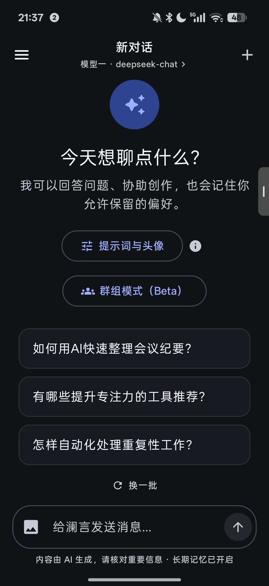

# 澜言 · LanYan

> 一个原生 Android AI 聊天客户端，参考 DeepSeek 的干净体验，支持多模型、图片理解、会话级人设与 Agent 记忆。

<p align="center">
  
</p>


---

## ✨ 功能

- **流式对话**：OpenAI 兼容接口，支持 DeepSeek / OpenAI / 通义兼容 / 本地 Ollama，SSE 实时输出、随时停止
- **多模型**：最多配置 4 个模型，新对话可切换；对话开始后模型锁定，避免上下文串味
- **多模态**：一次最多发送 3 张图片，原图上传，点击可全屏查看（需支持视觉的模型）
- **会话级人设**：每个对话可单独设置 AI 头像、用户头像、系统提示词；也可以在新对话开始前预设
- **消息编辑**：点击消息显示复制 / 修改，修改后自动重新生成回复；长回复可一键回到底部
- **长期记忆开关**：输入框上方可临时开关本机的长期记忆，不修改全局设置
- **聊天背景**：设置 → 外观 可选择一张图片作为聊天页背景，自动叠加半透明蒙层保证可读性
- **群组模式（Beta）**：选取 2–4 个已有对话作为智能体，拉进同一个群聊依次发言
- **Agent 记忆**：短期上下文 + 长期用户记忆 + 会话摘要三层结构，自动提取偏好与事实，可手动管理
- **体验细节**：AI 生成首页开场问题（本地缓存省 Token）、自动会话标题、深浅色主题、启动动画、头像裁剪

## 📱 环境

| 项目 | 要求 |
|---|---|
| 最低系统 | Android 8.0（API 26） |
| 目标版本 | Android 15（API 35） |
| 编译工具 | JDK 17、Android SDK 35、Gradle 8.9（wrapper 已内置） |

## 🚀 下载与安装

[](https://github.com/hailuo2456/LanYan/releases/latest)

点击上方按钮前往 [Releases](https://github.com/hailuo2456/LanYan/releases) 下载最新的 `LanYan-1.6.2.apk`，源码压缩包也在同一页面提供。

> 想体验旧版？见 [历史版本归档（1.0.0 – 1.4.0）](https://github.com/hailuo2456/LanYan/releases/tag/legacy-builds)（已废弃的液态玻璃 Beta 未收录）。

> 当前为调试签名版本，安装时系统可能提示"未知来源"，选择继续安装即可。

## 🧱 从源码构建

```bash
git clone https://github.com/hailuo2456/LanYan.git
cd LanYan

# 确保已安装 JDK 17 与 Android SDK 35
echo "sdk.dir=/path/to/Android/Sdk" > local.properties

./gradlew assembleDebug
```

产物：`app/build/outputs/apk/debug/app-debug.apk`

Windows 下把 `./gradlew` 换成 `gradlew.bat`。

## 🔑 配置模型

1. 打开澜言，点击左上角菜单 → **模型与偏好设置** → **模型服务**
2. 填写 **API 地址**、**API 密钥**、**模型名称**
3. 点「测试连接」确认可用，再保存

以 DeepSeek 为例：

| 字段 | 值 |
|---|---|
| API 地址 | `https://api.deepseek.com/v1` |
| API 密钥 | 在 <https://platform.deepseek.com/> → 左侧 **API Keys** 创建 |
| 模型名称 | `deepseek-chat`（或 `deepseek-reasoner`） |

- 最多可添加 4 个模型，每个模型的**名称必须唯一**；同一供应商可以配置多个不同模型
- 配置 2 个以上后，新对话标题下方的模型名会带 `>`，点击即可切换
- **对话开始后不能更换模型**，此时点击会提示开启新对话
- 本地服务（如 Ollama）：地址填 `http://<局域网IP>:11434/v1`，密钥留空

## 🧠 记忆与隐私

- 短期：最近 N 条消息原文
- 长期：自动提取姓名、偏好、项目、事实等，按关键词 + 中文 bigram + 重要性 + 时间衰减检索
- 摘要：每 12 条未摘要消息合并一次，保留最近 4 条原文
- API 密钥通过 Android Keystore 加密，仅存本机；聊天记录、图片、记忆均保存在本地数据库与私有目录
- 发送的文字和图片会传给所配置的模型服务商，按其隐私政策处理

## 🛠 技术栈

| 分类 | 使用 |
|---|---|
| 语言 | Kotlin 2.0.21 |
| UI | Jetpack Compose + Material 3 |
| 架构 | 单 Activity + Compose Navigation + ViewModel + Repository |
| 本地存储 | Room（KSP）、DataStore Preferences |
| 安全 | EncryptedSharedPreferences / Android Keystore |
| 网络 | OkHttp 4.12（SSE 流式解析） |
| 序列化 | kotlinx.serialization |
| 图片 | Coil、AndroidX Photo Picker |

## 📂 项目结构

```text
app/src/main/java/com/lanyan/chat/
  LanYanApplication.kt        Application 与手动依赖容器
  MainActivity.kt             单 Activity + Compose Navigation
  data/
    local/                    Room 实体、DAO、设置/图片/头像存储
    model/                    ApiSettings、ModelProfile、PromptMessage
    remote/                   OpenAI 兼容客户端（含多模态）
    repository/               ChatRepository、MemoryRepository
  domain/                     记忆引擎、记忆整理、检索、开场问题生成
  ui/                         ViewModel、聊天/设置/记忆页面、通用组件
app/src/test/                 单元测试
app/schemas/                  Room 各版本 schema
docs/                         开发文档与截图
```

更细的模块说明、数据库迁移链与构建环境见 [docs/DEVELOPMENT.md](docs/DEVELOPMENT.md)。

## 🗺 Roadmap

- [x] 多模型配置与对话内切换
- [x] 图片消息（原图）
- [x] 会话级 AI / 用户头像与系统提示词
- [x] 群组模式（Beta）
- [ ] 群组模式正式版：指定发言人、成员互相接话
- [ ] 消息重新生成 / 编辑 / 删除
- [ ] 会话导出与导入
- [ ] 文件附件
- [ ] 发布版签名
- [ ] 向量化记忆检索

## 🤝 贡献

欢迎提交 Issue 与 Pull Request。提交前请确保：

- `./gradlew testDebugUnitTest lintDebug assembleDebug` 通过
- 新功能尽量补充单元测试
- 代码风格与现有实现保持一致（Kotlin + Compose，中文文案）

## ⚠️ 说明

- 本项目与 DeepSeek、OpenAI 等服务商无任何关联
- 使用需要自备模型 API Key，产生的费用由对应服务商收取
- AI 生成内容可能存在错误，请自行核对重要信息

## 📄 License

本项目基于 [MIT License](LICENSE) 开源，Copyright (c) 2026 hailuo2456。
